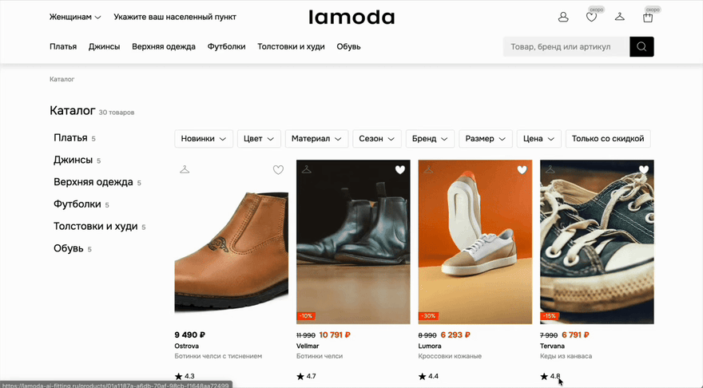
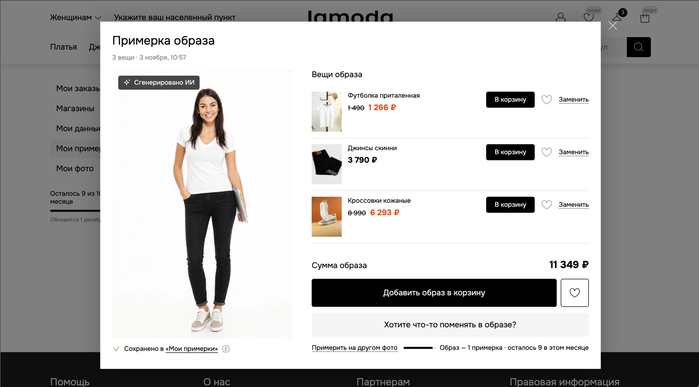
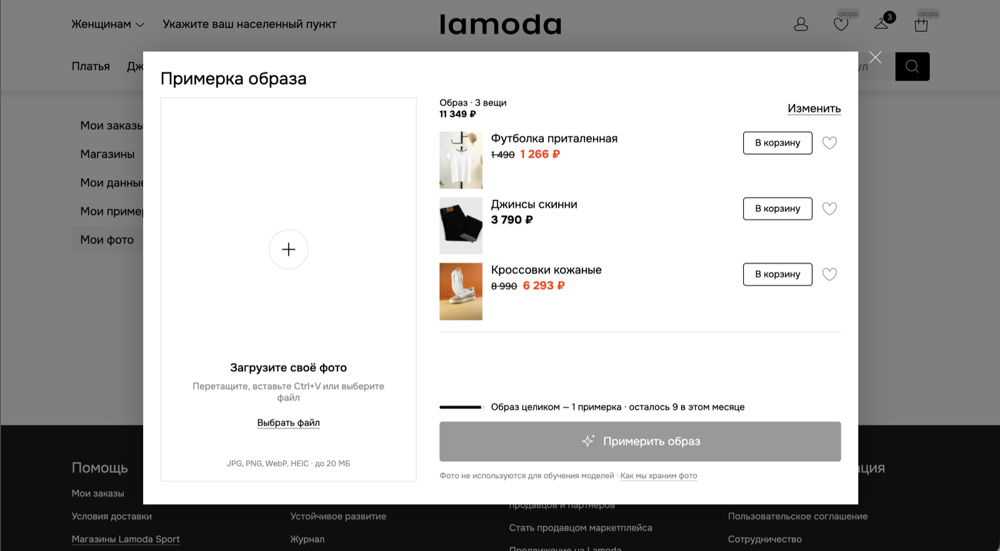
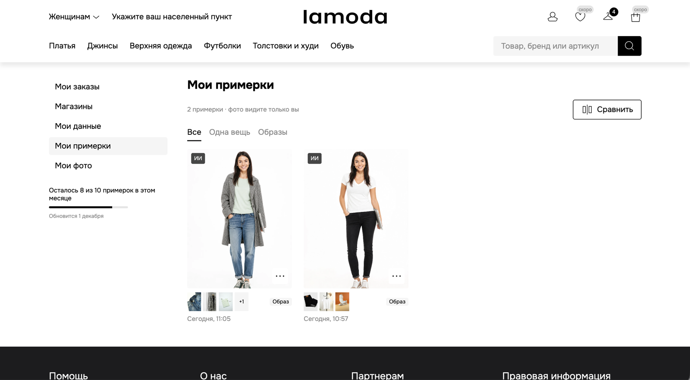
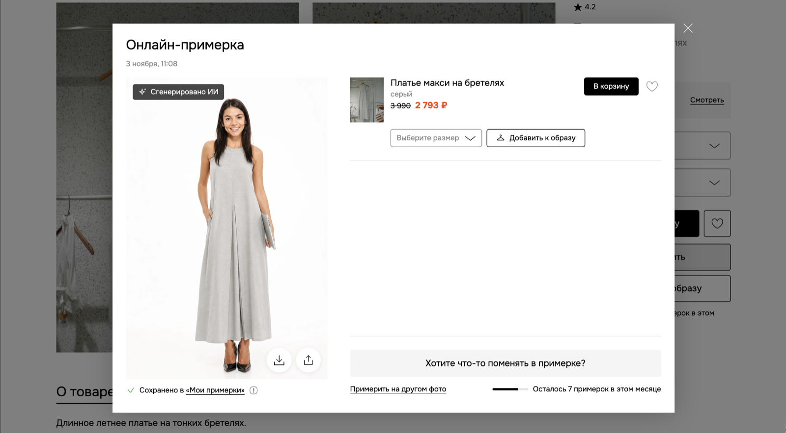
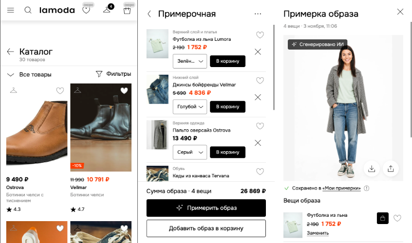
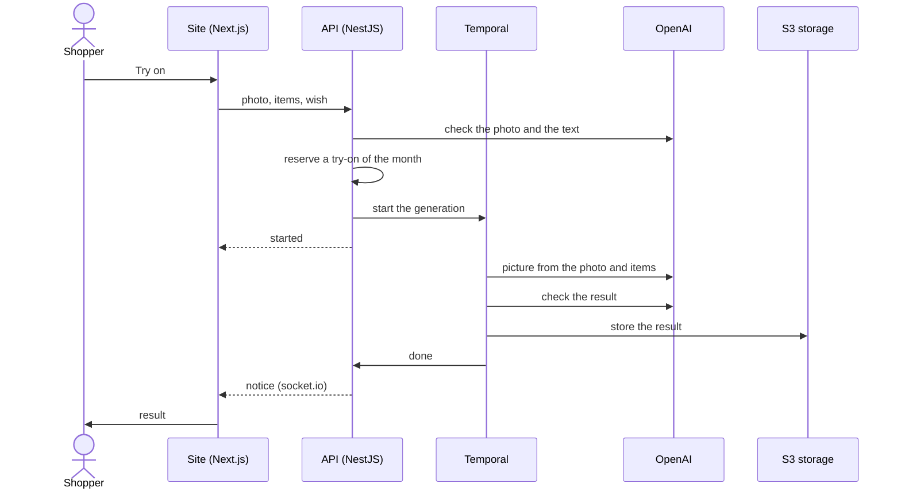

<div align="center">

# Lamoda AI Fitting

**Try on one item or a whole outfit on your own photo — right in the catalog**

[](https://github.com/EvaFridman/lamoda-ai-fitting/actions/workflows/ci.yml)
[](https://github.com/EvaFridman/lamoda-ai-fitting/actions/workflows/cd.yml)

**[Try it at lamoda-ai-fitting.ru →](https://lamoda-ai-fitting.ru)**

[Русский](README.md) · English



</div>

> The site and its interface are in Russian.

## Why

Clothes online are bought by eye: how an item looks on a model is one thing, on yourself quite
another. That means
doubts before buying, and returns after. Lamoda AI Fitting shows the item on the shopper's own
photo: press «Примерить» (Try on) on a product page and soon you see yourself wearing it. Put a top,
a bottom, outerwear and shoes into the fitting room, and you get a picture of the whole outfit.

This is an independent working prototype for Lamoda: the catalog is a demo one, and there is no
cart or checkout. Sign in with Google; each user gets 10 try-ons a month.

## What it does

<table>
<tr>
<td width="50%" valign="top">

**A whole outfit.** The hanger on a product card puts the item into the fitting room. Two to four
items become one picture, and the wishes field can ask, say, to tuck the shirt in.



</td>
<td width="50%" valign="top">

**Your own photos.** Up to five saved ones, or a one-time photo. Drag it in, paste it, or take it
with the phone's camera. A photo that does not fit is refused with a clear reason, and the try-on
limit is not spent.



</td>
</tr>
<tr>
<td width="50%" valign="top">

**Nothing gets lost.** The window can be closed while the picture is generated: the site shows a
notice when it is ready. Every result stays in the history, the same try-on again is free, and two
results can be compared side by side.



</td>
<td width="50%" valign="top">

**Fix what you don't like.** «Что поменять?» (What to change?) redoes the picture from a comment,
the first time for free. The result can be downloaded or shared.



</td>
</tr>
</table>

Around the try-on is a storefront in Lamoda's style: the catalog with search and filters, product
pages, the account, stores on a map. All of it works on phones too.

<p align="center">
  
</p>

## How it works



- **Checks before generating.** An AI model checks the photo and the wish: one adult, full height;
  a wish about fit and style, not about other people or forbidden content. A refusal says why and
  does not spend the try-on limit.
- **Generations are not lost.** Temporal keeps each try-on's state: one that fails or hangs does not
  vanish silently, it ends with an error and gives the try-on back.
- **Paid once.** The same try-on (the same photo, items and colours) opens the earlier result with
  no new generation.
- **Photos stay private.** They live in a private bucket and open only through short-lived signed
  links. Deleting the account deletes every photo and try-on result with it.

## Under the hood

| Layer         | What we use                                                                          |
| ------------- | ------------------------------------------------------------------------------------ |
| Site          | Next.js 16, React 19, TanStack Query, Zustand, Base UI, SCSS, Feature-Sliced Design  |
| API           | NestJS 12, Prisma 7, PostgreSQL 18, Redis 8, socket.io, Better Auth (Google sign-in) |
| Generation    | Temporal, OpenAI (images and checks) through a proxy abroad                          |
| Storage       | S3, nightly encrypted backups of the database and files                              |
| Observability | Sentry, pino logs, Mixpanel (only after cookie consent)                              |
| Server        | Docker Compose, nginx, blue-green deploys with no downtime                           |

- **UI kit.** About fifty components built to Lamoda's styles: buttons, filters, dialogs, sheets, a
  gallery. See them at [lamoda-ai-fitting.ru/ui-kit](https://lamoda-ai-fitting.ru/ui-kit).
- **Deploys.** Every merge into `main` is checked and deployed by itself: the new copy is warmed up
  and gets traffic only after its checks pass, while the old one serves until the switch.
- **Tests.** Over 500 test files; the database tests run against real PostgreSQL, S3 and Temporal
  in throwaway containers.

## How we build it

The project follows **Spec-Driven Development**: spec → the owner's decisions → plan → tasks →
code. Every decision is written down with its reason in [`specs/`](specs/), and a task is done
once its tests and reviews pass.

AI assistants with clear roles help: one writes tests, another checks the site as a QA engineer,
others review the code and its security. They search the project through **RAG over the code**
([`tools/code-rag`](tools/code-rag/)): the repository is cut into chunks, turned into vectors and
kept in SQLite with sqlite-vec and a full-text index, so an assistant finds the right place by
meaning. The same search helps investigate production errors from Sentry.

Over 100 pull requests and 500 commits in the first month.

## What's next

- **Size.** Show how the chosen size fits and suggest the right one — the main lever on returns.
- **Lamoda's cart and favourites.** From the result straight to the cart, the whole outfit or item
  by item.
- **A backdrop for the items.** Linen on a summer street, a coat in an autumn city.
- **A digital twin.** Photo, height, size and style, given once.
- **Accessories and links.** The fitting room's fifth slot; share a link instead of a file.

Testing it at Lamoda takes two steps: a pilot on 200–300 products (how many bad pictures, how fast,
how much it costs), then an A/B test (do people add to cart, do they buy, are there fewer returns
over size).

## For developers

```bash
npm ci
./scripts/init-env.sh
docker compose up -d --wait
docker compose run --rm api npx prisma migrate deploy
docker compose run --rm api npm run seed:dev
```

The site opens at http://localhost:3001. Requirements, every command, the local services and
investigating errors (in Russian): [docs/development.md](docs/development.md). Deploys and the
server: [deploy/README.md](deploy/README.md). Rules for people and agents:
[CONTRIBUTING.md](CONTRIBUTING.md), [CLAUDE.md](CLAUDE.md).

## License

© 2026 Eva Fridman. All rights reserved: the code is published for viewing only and may not be
used without the author's written permission ([LICENSE](LICENSE)).
