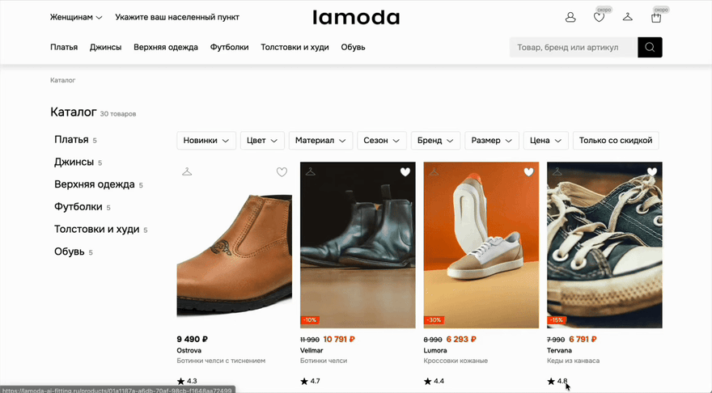
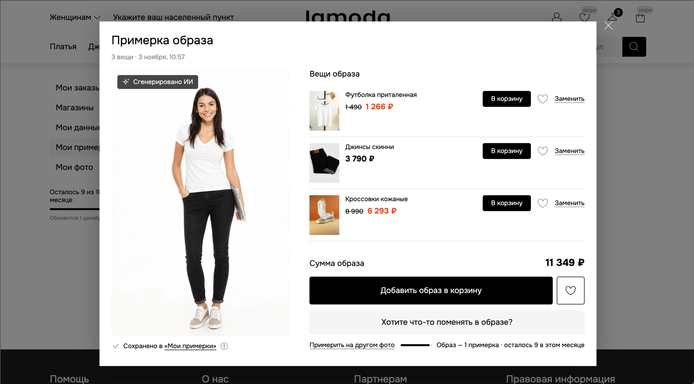
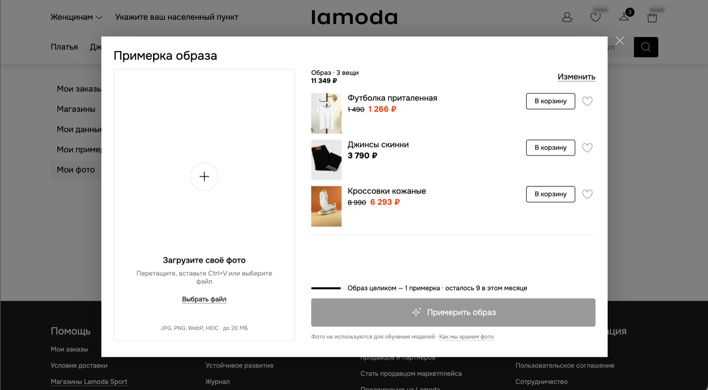
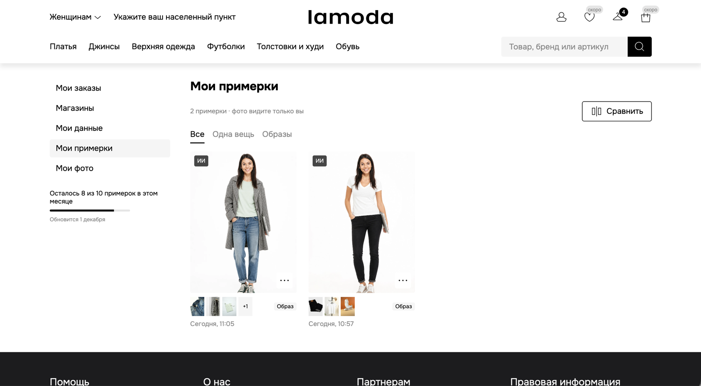
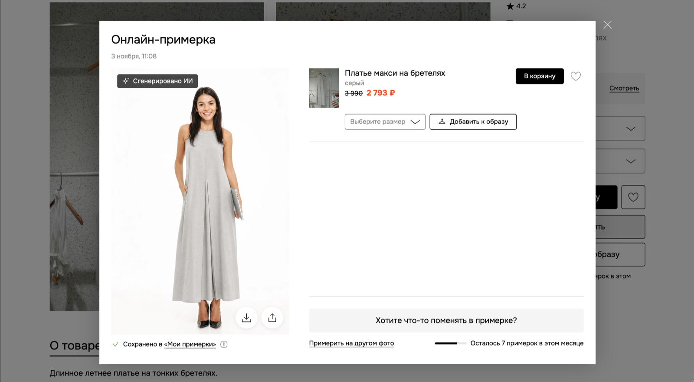
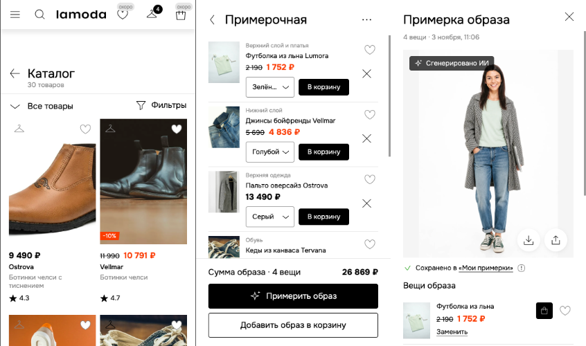
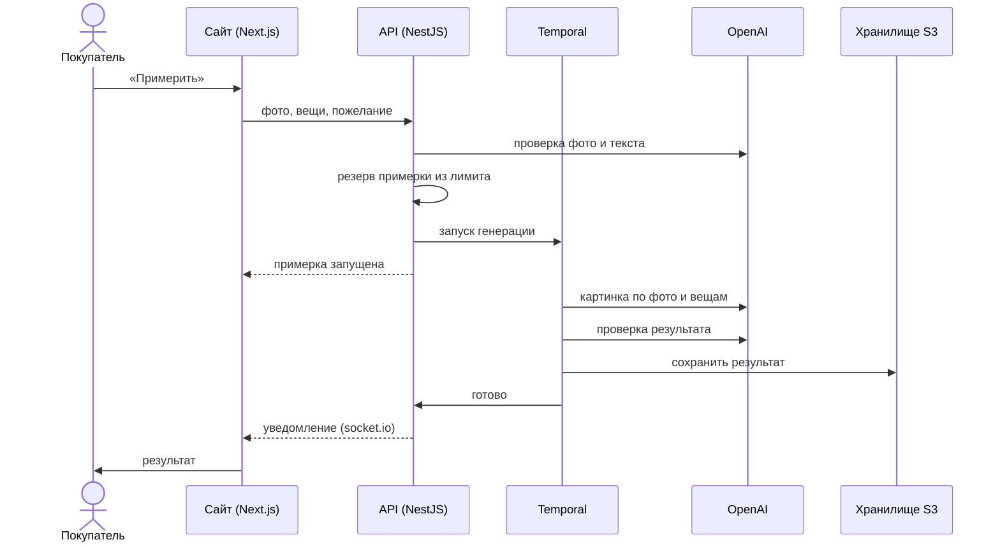

<div align="center">

# Lamoda AI Fitting

**Примеряйте на своём фото одну вещь или целый образ — прямо в каталоге**

[](https://github.com/EvaFridman/lamoda-ai-fitting/actions/workflows/ci.yml)
[](https://github.com/EvaFridman/lamoda-ai-fitting/actions/workflows/cd.yml)

**[Попробовать на lamoda-ai-fitting.ru →](https://lamoda-ai-fitting.ru)**

Русский · [English](README.en.md)



</div>

## Зачем

Одежду в интернете выбирают на глаз: то, как вещь выглядит на модели, — это одно, а на себе — совсем другое. Отсюда сомнения перед покупкой и возвраты. Lamoda AI Fitting показывает вещь на фото самого покупателя: нажал «Примерить» на странице товара — и вскоре видишь себя в ней. А если собрать
в примерочной верх, низ, верхнюю одежду и обувь — получится картинка целого образа.

Это независимый работающий прототип для Lamoda: каталог демонстрационный, корзины и заказов нет.
Войти можно через Google, у каждого пользователя 10 примерок в месяц.

## Что умеет

<table>
<tr>
<td width="50%" valign="top">

**Целый образ.** Вешалка на карточке кладёт вещь в примерочную. Из 2–4 вещей получается одна
картинка, а в графе для пожеланий можно попросить, например, заправить рубашку.



</td>
<td width="50%" valign="top">

**Свои фото.** До пяти сохранённых или одно разовое. Фото можно перетащить, вставить из буфера
или снять камерой телефона. Неподходящее фото отклоняется с понятной причиной, и лимит примерок не тратится.



</td>
</tr>
<tr>
<td width="50%" valign="top">

**Ничего не теряется.** Пока картинка генерируется, окно можно закрыть: сайт пришлёт
уведомление. Все результаты лежат в «Мои примерки», повтор той же примерки бесплатный, а две
можно сравнить рядом.



</td>
<td width="50%" valign="top">

**Можно поправить.** «Что поменять?» переделывает картинку по комментарию, первый раз бесплатно. Результат можно скачать или отправить.



</td>
</tr>
</table>

Вокруг примерки — витрина в стиле Lamoda: каталог с поиском и фильтрами, страница товара, личный
кабинет, магазины на карте. Всё работает и на телефоне.

<p align="center">
  
</p>

## Как это работает



- **Проверка до генерации.** Фото и пожелание проверяет ИИ-модель: на снимке один взрослый человек
  в полный рост, текст про посадку и стиль, а не про посторонних людей и/или запрещенный контент. Отказ объясняет причину и не тратит лимит примерок.
- **Генерация не теряется.** Её ведёт Temporal, который хранит состояние каждой примерки:
  упавшая или зависшая примерка не пропадёт молча, а закончится ошибкой и вернёт попытку в лимит.
- **Платим один раз.** Одинаковая примерка (то же фото, те же вещи и цвета) открывает готовый
  результат без новой генерации.
- **Фото под защитой.** Фото хранятся в закрытом бакете и открываются только по временным
  ссылкам. Удалённый аккаунт уносит с собой все фото и результаты примерок.

## Под капотом

| Слой       | Что используем                                                                          |
| ---------- | --------------------------------------------------------------------------------------- |
| Сайт       | Next.js 16, React 19, TanStack Query, Zustand, Base UI, SCSS, Feature-Sliced Design     |
| API        | NestJS 12, Prisma 7, PostgreSQL 18, Redis 8, socket.io, Better Auth (вход через Google) |
| Генерация  | Temporal, OpenAI (картинки и проверки) через прокси за рубежом                          |
| Хранилище  | S3, ночные зашифрованные бэкапы базы и файлов                                           |
| Наблюдение | Sentry, логи pino, Mixpanel (только после согласия на cookie)                           |
| Сервер     | Docker Compose, nginx, blue-green деплой без простоя                                    |

- **UI-кит.** Около пятидесяти компонентов, сверстанных по стилям Lamoda: кнопки, фильтры, окна,
  шторки, галерея. Их можно посмотреть на странице
  [lamoda-ai-fitting.ru/ui-kit](https://lamoda-ai-fitting.ru/ui-kit).
- **Деплой.** Каждый merge в `main` проверяется и выкатывается сам: новая копия прогревается и
  получает трафик только после проверок, а старая работает до переключения.
- **Тесты.** Больше 500 файлов тестов; тесты базы идут на настоящих PostgreSQL, S3 и Temporal в
  одноразовых контейнерах.

## Как разрабатываем

Проект ведётся по **Spec-Driven Development**: спецификация → решения владельца → план → задачи →
код. Каждое решение записано и объяснено в [`specs/`](specs/), а задача считается сделанной, когда
прошли тесты и ревью.

В работе помогают ИИ-ассистенты с чёткими ролями: один пишет тесты, другой проверяет сайт как
тестировщик, третьи ревьюят код и безопасность. Для них есть **RAG по коду**
([`tools/code-rag`](tools/code-rag/)): репозиторий разбит на кусочки, превращён в векторы и
сложен в SQLite с sqlite-vec и полнотекстовым индексом, так что ассистент ищет нужное место по
смыслу. Тот же поиск помогает разбирать ошибки продакшена из Sentry.

Больше 100 пул-реквестов и 500 коммитов за первый месяц.

## Куда дальше

- **Размер.** Показать посадку выбранного размера и подсказать нужный — главное для возвратов.
- **Корзина и избранное Lamoda.** Из результата сразу в корзину — образ целиком или по вещам.
- **Фон под вещи.** Лён — летняя улица, пальто — осенний город.
- **Цифровой двойник.** Фото, рост, размер и стиль — один раз при знакомстве.
- **Аксессуары и ссылка.** Пятый слот примерочной; делиться ссылкой, а не файлом.

Проверить на Lamoda — в два шага: пилот на 200–300 товарах (сколько брака, как быстро, сколько
стоит), затем A/B-тест (кладут ли в корзину, выкупают ли, меньше ли возвратов по размеру).

## Для разработчиков

```bash
npm ci
./scripts/init-env.sh
docker compose up -d --wait
docker compose run --rm api npx prisma migrate deploy
docker compose run --rm api npm run seed:dev
```

Сайт откроется на http://localhost:3001. Требования, все команды, локальные сервисы и
расследование ошибок: [docs/development.md](docs/development.md). Деплой и сервер:
[deploy/README.md](deploy/README.md). Правила для людей и агентов:
[CONTRIBUTING.md](CONTRIBUTING.md), [CLAUDE.md](CLAUDE.md).

## Лицензия

© 2026 Eva Fridman. Все права защищены: код опубликован для ознакомления, использовать его без
письменного разрешения автора нельзя ([LICENSE](LICENSE)).
